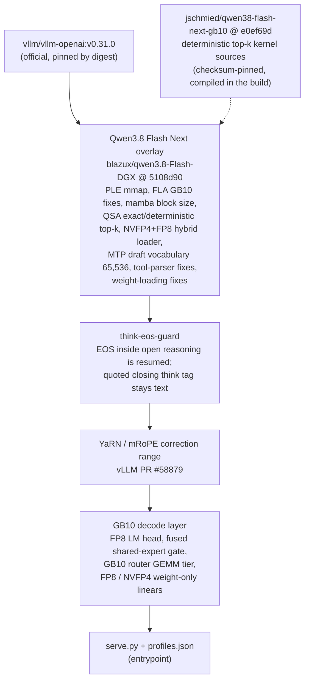
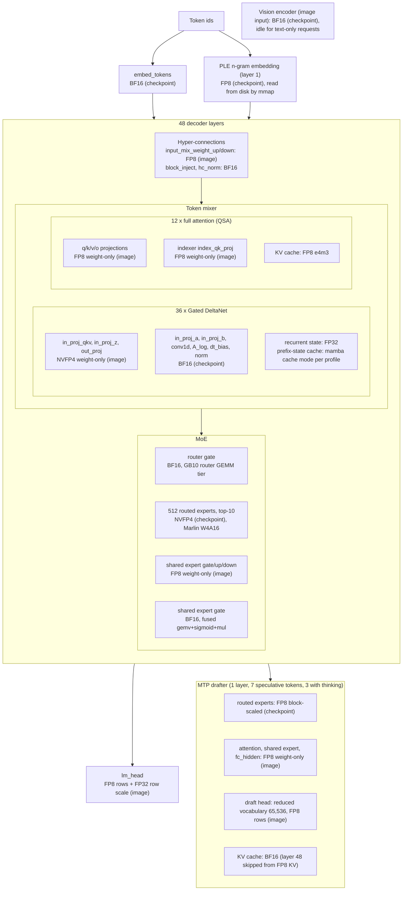

# Qwen3.8 Flash Next: architecture

How images are built in general: [docs/image.md](../../docs/image.md).

## Image layers

This is the image for vLLM 0.31 (`Dockerfile.vllm-0.31`, `VLLM=0.31`). The image for vLLM 0.32 (`Dockerfile.vllm-0.32`, the
default) has the same layers on vLLM 0.32.0, with steps 1 and 4 of the overlay and the think-eos-guard and YaRN diffs
adapted to 0.32, and two more layers before the entrypoint: the CuTeDSL warm-up fix (`gb10/cutedsl-warmup`) and the MTP draft
rope fix (`gb10/mtp-draft-rope`). On 0.32 the server uses the Humming MoE kernels instead of Marlin ([pins](pins.md),
[vLLM 0.31 against 0.32](vllm-versions.md)).

## Model components and precision

Qwen3.8 Flash Next: 48 decoder layers (36 Gated DeltaNet linear-attention layers + 12 full-attention layers, every 4th:
3, 7, ..., 47), MoE in every layer (512 routed experts, 10 active, + 1 shared expert), hidden size 2560, vocabulary 248,320,
one MTP layer, native context 262,144.

"Checkpoint" = as stored in `nvidia/Qwen3.8-Flash-Next-NVFP4`. "Image" = converted at load time by the GB10 layer of this image.

| Component | Checkpoint | Served as | Switch |
|---|---|---|---|
| Routed experts (512 x 48 layers) | NVFP4 | NVFP4, Marlin MoE backend | `--moe-backend marlin` |
| Gated DeltaNet projections `in_proj_qkv`, `in_proj_z`, `out_proj` | BF16 | NVFP4 weight-only (e2m1 + FP8 scale per 16 + FP32 row scale) | `VLLM_GB10_FP4_WEIGHTS=1` |
| Attention `q/k/v/o`, indexer `index_qk_proj` | BF16 | FP8 weight-only + FP32 row scale | `VLLM_GB10_FP8_WEIGHTS=1` |
| Shared expert `gate/up/down` | BF16 | FP8 weight-only | `VLLM_GB10_FP8_WEIGHTS=1` |
| Hyper-connection `input_mix_weight_up/down` | BF16 | FP8 weight-only | `VLLM_GB10_FP8_WEIGHTS=1` |
| `lm_head` | BF16 | FP8 rows + FP32 row scale | `VLLM_GB10_FP8_LMHEAD=1` (default) |
| MTP experts | FP8 block-scaled | FP8 block-scaled | - |
| MTP attention, shared expert, `fc_hidden` | BF16 | FP8 weight-only (FP4 skipped for `mtp`) | `VLLM_GB10_FP8_WEIGHTS=1`, `VLLM_GB10_FP4_SKIP=mtp` |
| MTP draft head | - | 65,536-token vocabulary, FP8 rows | `VLLM_MTP_DRAFT_VOCAB`, `VLLM_GB10_FP8_DRAFT_HEAD=1` (default) |
| PLE n-gram embedding | FP8 | FP8, read from disk (mmap) | `VLLM_PLE_MMAP=1` |
| `embed_tokens`, norms, router gate, GDN `in_proj_a/b`, `conv1d`, vision encoder | BF16 | BF16 | - |
| KV cache, 12 attention layers | - | FP8 e4m3 | `--kv-cache-dtype fp8_e4m3` |
| KV cache, MTP layer (48) | - | BF16 | `--kv-cache-dtype-skip-layers 48` |
| Gated DeltaNet recurrent state | FP32 | FP32 | - |

Weight-only means activations stay BF16; weights are dequantized inside the GEMM kernels.

The vision encoder (0.84 GiB) is loaded at start and runs only for requests that contain images. An image costs one
token per 32x32 pixels (16-pixel patches, 2x2 merge): at least 64 tokens, 768 for 1024x768, at most 16,384 (larger
images are scaled down). The MTP drafter is text-only.
